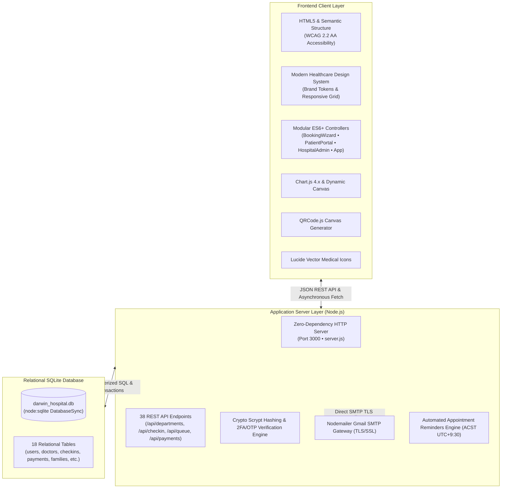

# 🏥 Darwin City Hospital — Advanced Digital Healthcare Platform

> **Educational & Professional Portfolio Project**  
> **Location:** Darwin, Northern Territory, Australia (Rocklands Drive, Tiwi NT 0810)  
> **Australian Emergency:** Dial 000 | **Hospital Desk:** (08) 8999 0000  
> **Timezone:** Australian Central Standard Time (ACST • UTC+9:30)  
> **Live Web Server:** [http://localhost:3000](http://localhost:3000)

---

## 🌟 Executive Summary

**Darwin City Hospital (DCH)** is an enterprise-grade digital healthcare management system engineered as a realistic, modern, and comprehensive platform for a fictional tertiary referral medical centre and Level-1 Trauma Centre in Darwin, Northern Territory.

Developed using modern full-stack web standards, the system features a zero-dependency **Node.js HTTP & REST API server**, a persistent **SQLite relational database** (powered by Node.js built-in `node:sqlite`), real **Nodemailer Gmail SMTP 2FA/OTP email verification**, an interactive **7-Step Appointment Booking System**, **3 distinct role-based dashboards** (Patient, Doctor, Admin with Chart.js), **Contactless Digital Check-in**, **Live De-Identified Outpatient Queue Display**, **Telehealth Virtual Clinic Simulator**, **Digital Patient ID Card with QR Verification**, **Stripe Consultation Payment & Medicare Rebate Simulation**, **Multi-Language Support (English, Nepali, Hindi)**, and a fully accessible, WCAG 2.2 AA compliant healthcare design system.

---

## 🎨 Design System & Brand Palette

The platform is built with a trustworthy, clean healthcare aesthetic adhering to strict accessibility contrast requirements:

| Element | Color Code | Purpose |
| :--- | :--- | :--- |
| **Primary Blue** | `#005B96` | Primary buttons, headers, active navigation states |
| **Secondary Teal** | `#009688` | Specialty badges, clinical icons, success highlights |
| **Dark Navy** | `#0F172A` | Top navigation, footer, dark cards, high-contrast headings |
| **Light Canvas** | `#F4F8FB` | Main background surface, accessible reading contrast |
| **Pure White** | `#FFFFFF` | Cards, modal containers, appointment passes |
| **Emergency Red** | `#DC2626` | Emergency 000 call badges, trauma indicators, critical alerts |

- **Typography:** `Inter` for crisp body legibility and `Poppins` for authoritative medical headings.
- **Icons:** Professional `Lucide Icons` throughout all components, replacing emojis.
- **Accessibility:** Built-in font size scaler (`A-` / `A+`), Dark / Light mode toggle, keyboard navigation, and ARIA labels conforming to WCAG 2.2 AA.

---

## 🏗️ Technical Architecture



---

## 🗄️ Relational Database Schema (18 Tables)

The database is powered by Node.js 26's built-in `node:sqlite` (`DatabaseSync`), requiring zero external native compilation dependencies:

1. **`users`**: User authentication, role (`patient`, `doctor`, `admin`), cryptographic salt, and `scrypt` password hash.
2. **`departments`**: 14 clinical medical departments, description, treatments array, lead physician, room, operating hours.
3. **`doctors`**: 15 specialist doctor profiles, qualifications, experience, spoken languages, consultation fee in AUD, biography, room.
4. **`patients`**: Extended medical profile, Medical Record Number (`DCH-MRN-XXXX`), blood group, Medicare number, emergency contact.
5. **`doctor_availability`**: Timetables and open consultation slot duration (30 mins).
6. **`appointments`**: Unique reference (`DCH-XXXXXX`), doctor ID, date, time slot, status (`confirmed`, `pending`, `completed`, `cancelled`), symptoms, fee. Includes atomic unique constraint on `(doctor_id, appointment_date, time_slot)` to prevent double booking.
7. **`email_otps`**: Secure 6-digit OTP verification codes, hashed token, 5-minute expiry, cooldown timestamp, verification status.
8. **`email_logs`**: Full audit log of all outbound SMTP delivery attempts, recipient addresses, subjects, timestamps, and delivery statuses.
9. **`medical_records`**: Pathology panels, resting 12-lead ECG reports, diagnostic imaging summaries.
10. **`prescriptions`**: Active e-prescriptions, dosage, frequency, refills remaining, pharmacy instructions.
11. **`notifications`**: Patient alerts, test result notices, booking confirmation pings.
12. **`contact_enquiries`**: General enquiries submitted via the contact form with admin response tracking.
13. **`health_articles`**: Medical guides and health education articles.
14. **`audit_logs`**: Security logs tracking sensitive administrative and clinical events.
15. **`checkins`**: Contactless arrivals, ticket numbers (`Q-041`), arrival timestamps, de-identified QR verification tokens, status (`checked-in`, `called`, `in-consultation`, `completed`).
16. **`patient_families`**: Dependent family profiles linked to primary patient (spouses, children, elders) with DOB, blood group, and emergency contact details.
17. **`payments`**: Simulated Stripe checkout intents, amounts in AUD, Medicare rebates, payment method details, and tax invoice receipts.
18. **`patient_feedback`**: Doctor ratings (1-5 stars), verified patient comments, clinical quality feedback, and administrative moderation flags.
19. **`doctor_favorites`**: Patient-curated bookmarks of preferred specialists.
20. **`reminder_logs`**: Audit trail of automated appointment reminder emails and SMS alerts sent 24-48 hours before scheduled visits.

---

## 🩺 14 Clinical Specialties & Departments

1. **Cardiology & Heart Health** (Catheter lab, 24/7 angioplasty, Dr. Sarah Jenkins)
2. **Neurology & Stroke Unit** (Acute stroke thrombolysis protocol, EEG, Dr. Alexander Vance)
3. **Orthopaedics & Joint Surgery** (Mako robotic total joint replacement, Dr. Marcus Brody)
4. **Paediatrics & Child Health** (Neonatal checks, child development, Dr. Emily Watson)
5. **General & Internal Medicine** (Multisystem chronic disease, Dr. David K. Chen)
6. **Emergency Medicine & Trauma** (24/7 Level-1 trauma resus, Dr. Rachel Green)
7. **Maternity & Women's Health** (Birthing suites, antenatal, Dr. Olivia Taylor)
8. **Dermatology & Skin Cancer** (Mohs surgery, melanoma screening, Dr. James Wilson)
9. **Radiology & Diagnostic Imaging** (3T MRI, 128-slice CT, ultrasound, Dr. Kevin Patel)
10. **Oncology & Cancer Care** (Day infusion lounge, genomics, Dr. Meera Nambiar)
11. **Physiotherapy & Rehabilitation** (Heated hydrotherapy pool, sports rehab, Liam O'Connor)
12. **Mental Health & Wellbeing** (Psychiatric evaluations, CBT, Dr. Hannah Scott)
13. **Dental & Maxillofacial Care** (Surgical extractions, facial trauma, Dr. Anthony Ross)
14. **Pathology & Clinical Laboratory** (NATA accredited stat lab, blood bank, Dr. Fiona Stewart)

---

## 👨‍⚕️ 15 Specialist Doctors & Multi-Faceted Directory

Every specialist profile includes full academic credentials, Australian fellowships, years of experience, spoken languages, room location, consultation fee in AUD, and interactive profile modals. The directory features real-time multi-attribute filtering:

- **Filter by Department:** Cardiology, Neurology, Orthopaedics, Paediatrics, etc.
- **Filter by Spoken Language:** English, Nepali, Hindi, Mandarin, Spanish, French.
- **Filter by Experience Level:** 10+ years, 15+ years, 20+ years of practice.
- **Live Search:** Instant keyword matching across doctor names, subspecialties, and bio keywords.
- **Doctor Favorites:** 1-click heart toggle to save preferred doctors to the patient profile.

---

## 📱 Advanced Platform Features

### 1. Digital Patient ID Card
- Unique Medical Record Number (`DCH-MRN-9021`).
- Dynamically rendered QR Code via QRCode.js.
- **Privacy First:** QR payload contains only a non-sensitive verification identifier token — zero medical histories or passwords exposed.
- One-click print / download button for patient check-in at reception kiosks.

### 2. Contactless Digital Check-in & Live Queue Board
- Patients check in on arrival by entering their appointment reference (`DCH-XXXXXX`).
- Generates a queue ticket (`Q-041`) and digital boarding token.
- **Live Outpatient & Emergency Wait Times:** Publicly accessible live wait times board (`/api/queue/live`) displaying current ticket numbers, consulting doctors, consulting rooms, and estimated wait times.
- **Privacy & Healthcare De-Identification:** Patient names and clinical diagnoses are completely excluded from public queue displays.

### 3. Telehealth Virtual Consultation Simulator
- Complete in-browser telehealth consultation suite.
- Live camera video preview with picture-in-picture doctor stream.
- In-call controls: Camera Toggle, Microphone Mute, Call End.
- Elapsed call timer and real-time clinical chat simulator.
- Post-consultation digital summary.

### 4. Online Payment Simulation (Stripe & Medicare)
- Consultation fee checkout with Medicare itemized rebate calculations (e.g. Standard Consult $220 AUD, Medicare Rebate $82.30 AUD, Out-of-Pocket $137.70 AUD).
- Test-mode card payment simulator with instant tax invoice and receipt reference generation.
- Complete payment history ledger accessible in the Patient Portal.

### 5. Multilingual Localization (English, Nepali, Hindi)
- Real-time language selector in the top bar (`English`, `नेपाली`, `हिन्दी`).
- Instant client-side DOM translation without page reloading.
- Backed by server-side translation endpoints (`/api/translations/:lang`).

### 6. Automated Appointment Reminders Engine
- Server-side scheduler running on ACST timezone (UTC+9:30).
- Automatically identifies appointments scheduled 24 to 48 hours ahead.
- Dispatches email alerts and records an audit log in `reminder_logs`.
- Manual on-demand reminder trigger available in the Admin Console.

### 7. Patient Family Profiles & Dependent Management
- Patients can register family members (children, spouses, parents) directly from their portal.
- Tracks relationship, date of birth, gender, and blood group for family healthcare coordination.

### 8. Clinical Reports & e-Prescription Downloads
- Download pathology panels, resting ECGs, and digital prescriptions.
- Mandatory legal demonstration watermarks: `SAMPLE – NOT A VALID PRESCRIPTION` and `SAMPLE CLINICAL REPORT – DEMONSTRATION RECORD ONLY`.

### 9. Admin Operational Tools & CSV Reporting
- 1-Click CSV Export of all appointments and patient visits for administrative audits.
- Full email delivery logs viewer for SMTP debugging.
- Live hospital bed occupancy monitor across ICU, Trauma, Maternity, and General wards.

---

## 🔐 Demonstration Login Credentials

| Role | Email | Password |
| :--- | :--- | :--- |
| **Hospital Administrator** | `admin@darwinhospital.gov.au` | `DarwinAdmin2026!` |
| **Specialist Doctor** | `dr.jenkins@darwinhospital.gov.au` | `DoctorPass2026!` |
| **Patient** | `nirojkhattri33@gmail.com` | `PatientPass2026!` |

*(You can also use the one-click Role Switcher buttons inside the Portal section to instantly evaluate all three dashboard views.)*

---

## 🧪 Comprehensive Integration Test Suite (44 Tests, 100% Pass)

An automated integration test suite is included in `tests/integration_test.js` validating all 16 platform subsystems:

```bash
node tests/integration_test.js
```

### Verified Test Suites:
1. **SMTP Status Endpoint:** Configuration status verification.
2. **Send OTP API Endpoint:** Live Gmail SMTP and input validation.
3. **Database OTP Security & Rate Limiting:** Expiry, 60s cooldown, replay protection, token invalidation.
4. **Appointment Booking API & Collision Prevention:** Double booking prevention, past date lockout, reference generation.
5. **General Enquiry API:** Contact form submission and ticket generation.
6. **Admin Management & Logs APIs:** Enquiry responses, appointment searches, email audit logs.
7. **Digital Check-In & Live Queue APIs:** Arrival check-in, ticket generation, privacy de-identification.
8. **Patient Family Profiles:** Adding and retrieving dependent profiles.
9. **Online Stripe Payments:** Intent generation, payment confirmation, and receipt ledger.
10. **Patient Feedback & Quality Ratings:** Submission and public review display.
11. **Doctor Favorites API:** Specialist bookmarking and retrieval.
12. **Digital Patient ID Card:** ID card data and non-sensitive QR payload.
13. **Clinical Report & Prescription Downloads:** Watermarked HTML and prescription slips.
14. **Multilingual Translation Endpoints:** English, Nepali, and Hindi dictionary validation.
15. **Automated Reminders Scheduler:** ACST 24-48h appointment scan.
16. **Admin CSV Export:** RFC 4180 CSV export generation.

---

## 🚀 How to Run the Website

### Prerequisites
- Node.js version 22 or higher (Node.js 26 recommended for native `node:sqlite`).

### 1. Configure Environment Variables
Ensure `.env` contains your Gmail SMTP credentials (already pre-configured for demonstration):
```env
SMTP_USER=nirooj11@gmail.com
SMTP_PASS=kfgp ivut cjvy oypv
SMTP_HOST=smtp.gmail.com
SMTP_PORT=587
PORT=3000
```

### 2. Start the Web Server
```bash
node server.js
```

### 3. Open the Application
Navigate your browser to:  
👉 **[http://localhost:3000](http://localhost:3000)**

---

## ⚠️ Portfolio & Emergency Disclaimer

> **PLEASE NOTE:** Darwin City Hospital is a fictional Australian healthcare platform designed for educational, portfolio, and technical demonstration purposes. It does not provide real medical treatment, consultations, or emergency dispatches.
> 
> **In Australia, in a genuine medical emergency, immediately dial `000` for emergency ambulance and police services.**
