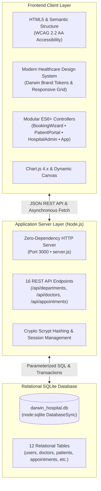

# 🏥 Darwin City Hospital — Master Healthcare Web Platform

> **Educational & Professional Portfolio Project**  
> **Location:** Darwin, Northern Territory, Australia  
> **Australian Emergency:** Dial 000 | **Outpatient Desk:** (08) 8999 0000  
> **Timezone:** Australian Central Standard Time (ACST • UTC+9:30)  
> **Live Local Web Server:** [http://localhost:3000](http://localhost:3000)

---

## 🌟 Executive Summary

**Darwin City Hospital (DCH)** is an enterprise-grade hospital web application engineered as a realistic, modern, and comprehensive platform for a fictional tertiary referral medical centre and Level-1 Trauma Centre in Darwin, Northern Territory.

Developed using modern full-stack web standards, the system features a zero-dependency **Node.js HTTP & REST API server**, a persistent **SQLite relational database** (powered by Node.js built-in `node:sqlite`), an interactive **7-Step Appointment Booking System**, **3 distinct role-based dashboards** (Patient, Doctor, Admin with Chart.js), and a fully accessible, WCAG 2.2 AA compliant healthcare design system.

---

## 🎨 Design System & Brand Palette

The platform is built with a trustworthy, clean healthcare aesthetic adhering to strict accessibility contrast requirements:

| Element | Color Code | Purpose |
| :--- | :--- | :--- |
| **Primary Blue** | `#005B96` | Primary buttons, headers, active navigation states |
| **Secondary Teal** | `#009688` | Specialty badges, clinical icons, success highlights |
| **Dark Navy** | `#0F172A` | Top navigation, footer, dark cards, high-contrast headings |
| **Light Canvas** | `#F4F8FB` | Main background surface, accessible reading contrast |
| **Pure White** | `#FFFFFF` | Cards, modal containers, appointment passes |
| **Emergency Red** | `#DC2626` | Emergency 000 call badges, trauma indicators, critical alerts |

- **Typography:** `Inter` for crisp body legibility and `Poppins` for authoritative medical headings.
- **Accessibility:** Built-in font size scaler (`A-` / `A+`), Dark / Light mode toggle, and ARIA labels.

---

## 🏗️ Technical Architecture



---

## 🗄️ Relational Database Schema (12 Tables)

The database is powered by Node.js 26's built-in `node:sqlite` (`DatabaseSync`), requiring zero third-party C++ compilation:

1. **`users`**: User authentication, role (`patient`, `doctor`, `admin`), cryptographic salt, and `scrypt` password hash.
2. **`departments`**: All 14 clinical medical departments, description, treatments array, lead physician, room, operating hours.
3. **`doctors`**: 15 specialist doctor profiles, qualifications, experience, spoken languages, consultation fee in AUD, biography, room.
4. **`patients`**: Extended medical profile, Medical Record Number (`DCH-MRN-XXXX`), blood group, Medicare number, emergency contact.
5. **`doctor_availability`**: Timetables and open consultation slot duration (30 mins).
6. **`appointments`**: Unique reference (`DCH-XXXXXX`), doctor ID, date, time slot, status (`confirmed`, `pending`, `completed`, `cancelled`), symptoms, fee. Includes atomic unique constraint on `(doctor_id, appointment_date, time_slot)` to prevent double booking.
7. **`medical_records`**: Pathology panels, resting 12-lead ECG reports, diagnostic imaging summaries.
8. **`prescriptions`**: Active e-prescriptions, dosage, frequency, refills remaining, pharmacy instructions.
9. **`notifications`**: Patient alerts, test result notices, booking confirmation pings.
10. **`contact_enquiries`**: General enquiries submitted via the contact form.
11. **`health_articles`**: Medical guides and health education articles.
12. **`audit_logs`**: Security logs tracking sensitive administrative and clinical events.

---

## 🩺 14 Clinical Specialties & Departments

1. **Cardiology & Heart Health** (Catheter lab, 24/7 angioplasty, Dr. Sarah Jenkins)
2. **Neurology & Stroke Unit** (Acute stroke thrombolysis protocol, EEG, Dr. Alexander Vance)
3. **Orthopaedics & Joint Surgery** (Mako robotic total joint replacement, Dr. Marcus Brody)
4. **Paediatrics & Child Health** (Neonatal checks, child development, Dr. Emily Watson)
5. **General & Internal Medicine** (Multisystem chronic disease, Dr. David K. Chen)
6. **Emergency Medicine & Trauma** (24/7 Level-1 trauma resus, Dr. Rachel Green)
7. **Maternity & Women's Health** (Birthing suites, antenatal, Dr. Olivia Taylor)
8. **Dermatology & Skin Cancer** (Mohs surgery, melanoma screening, Dr. James Wilson)
9. **Radiology & Diagnostic Imaging** (3T MRI, 128-slice CT, ultrasound, Dr. Kevin Patel)
10. **Oncology & Cancer Care** (Day infusion lounge, genomics, Dr. Meera Nambiar)
11. **Physiotherapy & Rehabilitation** (Heated hydrotherapy pool, sports rehab, Liam O'Connor)
12. **Mental Health & Wellbeing** (Psychiatric evaluations, CBT, Dr. Hannah Scott)
13. **Dental & Maxillofacial Care** (Surgical extractions, facial trauma, Dr. Anthony Ross)
14. **Pathology & Clinical Laboratory** (NATA accredited stat lab, blood bank, Dr. Fiona Stewart)

---

## 👨‍⚕️ 15 Specialist Doctors & Consultants

Every specialist profile includes full academic credentials, Australian fellowships, years of experience, spoken languages, room location, consultation fee in AUD, and interactive profile modals:

- **Dr. Sarah Jenkins** — MBBS (Hons), FRACP, FCSANZ, FACC (Cardiology • 16 yrs exp • $220 AUD)
- **Dr. Alexander Vance** — MD, PhD, FRACP (Neurology • 19 yrs exp • $240 AUD)
- **Dr. Marcus Brody** — MBBS, MS Orth, FRACS (Orthopaedics • 14 yrs exp • $250 AUD)
- **Dr. Emily Watson** — MBChB, FRACP Paed, DCH (Paediatrics • 12 yrs exp • $195 AUD)
- **Dr. David K. Chen** — MBBS, FRACP, FACP (General Medicine • 22 yrs exp • $180 AUD)
- **Dr. Rachel Green** — MBBS, FACEM (Emergency & Trauma • 11 yrs exp • $210 AUD)
- **Dr. Olivia Taylor** — MBBS, FRANZCOG, CMFM (Maternity & Ob/Gyn • 15 yrs exp • $230 AUD)
- **Dr. James Wilson** — MBBS, FACD (Dermatology • 13 yrs exp • $210 AUD)
- **Dr. Kevin Patel** — MBBS, FRANZCR, EBIR (Radiology • 17 yrs exp • $225 AUD)
- **Dr. Meera Nambiar** — MBBS, MD, FRACP Onc (Oncology • 14 yrs exp • $260 AUD)
- **Liam O'Connor** — B.Physio, M.MuscPhysio, APAM (Physiotherapy • 9 yrs exp • $140 AUD)
- **Dr. Hannah Scott** — MBBS, FRANZCP (Psychiatry & Mental Health • 16 yrs exp • $240 AUD)
- **Dr. Anthony Ross** — BDS, MBBS, FRACDS OMS (Oral & Maxillofacial • 12 yrs exp • $190 AUD)
- **Dr. Fiona Stewart** — MBBS, FRCPA, FIAC (Pathology • 18 yrs exp • $175 AUD)
- **Dr. Nathan Blake** — MBBS, FANZCA, FCICM (ICU & Anaesthesia • 15 yrs exp • $235 AUD)

---

## 📅 7-Step Appointment Booking System

The online booking system guides patients through seven strictly validated stages:

1. **Step 1: Specialty Selection** — Choose from 14 clinical departments.
2. **Step 2: Doctor Selection** — Select an attending specialist with live fee and credential preview.
3. **Step 3: Date Picker** — Enforces Australian date format, accepts bookings up to 90 days ahead, and strictly rejects past dates.
4. **Step 4: Time Slot Allocation** — Fetches live open slots from SQLite; locks out previously reserved slots.
5. **Step 5: Patient Intake** — Collects full name, Australian phone, email, date of birth, Medicare number, and symptoms.
6. **Step 6: Review Summary** — Consolidated review of all clinical and patient data before submission.
7. **Step 7: Official Consultation Pass** — Commits record to the database, generates unique `DCH-XXXXXX` reference, provides 1-Click Save in Gmail, printable slip, and downloadable `.EML` email pass.

---

## 👥 Multi-Role Portals & Dashboards

The website includes 3 distinct dashboards accessible via the role switcher or login modal:

### 1. Patient Portal
- Real-time view of scheduled visits, Medical Record Number (`DCH-MRN-9021`), and Medicare verification.
- **Reschedule & Cancel Actions:** Modifies appointments dynamically with SQLite synchronization.
- **Diagnostic Results:** View finalized pathology blood panels and resting 12-lead ECG reports.
- **E-Prescriptions:** Active medications, dosages, and refill counts.
- **Notification Center:** Clinical updates and test result alerts.

### 2. Doctor Portal
- Today's appointment schedule and patient queue.
- Consultation completion actions and clinical notes archiving.
- Live consultation availability status.

### 3. Administrator Console
- **Hospital Operations KPIs:** Total doctors (15), patients, total appointments, and today's visits.
- **Interactive Chart.js Analytics:** Monthly consultation trends line chart and specialty distribution doughnut chart.
- **Live Bed Capacity Tracker:** Real-time occupancy for ICU, Trauma, Maternity, Paediatrics, and General Wards.
- **Appointment Status Manager:** Update statuses (Confirmed, Pending, Completed, Cancelled).
- **Patient Enquiries Viewer:** Review incoming messages submitted via the Contact form.

---

## 🔐 Demonstration Login Credentials

| Role | Email | Password |
| :--- | :--- | :--- |
| **Hospital Administrator** | `admin@darwinhospital.gov.au` | `DarwinAdmin2026!` |
| **Specialist Doctor** | `dr.jenkins@darwinhospital.gov.au` | `DoctorPass2026!` |
| **Patient** | `nirojkhattri33@gmail.com` | `PatientPass2026!` |

*(You can also use the one-click Role Switcher buttons inside the Portal section to instantly evaluate all three dashboard views.)*

---

## 🤖 Advanced Features

- **Darwin CareBot Assistant:** Floating bottom-right assistant providing instant answers regarding visiting hours, clinics, location, and Medicare billing.
- **Global Search (`Ctrl+K`):** Instant modal search across all 14 departments, 15 specialists, and clinical services.
- **Accessibility Suite:** Font sizing buttons (`A-` / `A+`), Dark / Light theme toggle, and WCAG AA contrast compliance.
- **Custom 404 Page:** Professional medical-themed error page for invalid URLs.

---

## 🚀 How to Run the Website

### Prerequisites
- Node.js version 22 or higher (Node.js 26 recommended for native `node:sqlite`).

### Start the Server
```bash
npm start
```
*or*
```bash
node server.js
```

Then open your web browser to:  
👉 **[http://localhost:3000](http://localhost:3000)**

---

## ⚠️ Portfolio & Emergency Disclaimer

> **PLEASE NOTE:** Darwin City Hospital is a fictional Australian healthcare platform designed for educational, portfolio, and technical demonstration purposes. It does not provide real medical treatment, consultations, or emergency dispatches.
> 
> **In Australia, in a genuine medical emergency, immediately dial `000` for emergency ambulance and police services.**
